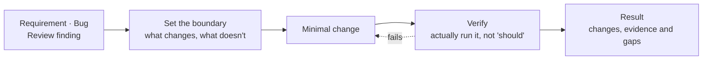

<div align="center">


# SOIA Open Dev Skills

**Stop letting the agent close a change with "should be fine"**

9 on-demand skills: engineering, architecture and UI methods

[中文](README.md) · English · [Ecosystem portal](https://github.com/soia-team/soia-open-skills)

<p align="center">
  
  
  
  
</p>

</div>

---

## What it solves

Choose one focused entry, read the relevant context, make a minimal complete change, and verify actual behavior. Ordinary tasks do not automatically add a panel, adversarial round, or repeated review.



## 9 skills

### 01 Change loop　`Requirement or bug → a change with scope, verification and review`

| Skill | Responsibility | Ready |
|---|---|:-:|
| [`soia-dev-enforce-coding-protocol`](skills/soia-dev-enforce-coding-protocol/SKILL.md) | Short scope, authority and risk-based verification constraints; no extra workflow | ✅ |
| [`soia-dev-implement-task`](skills/soia-dev-implement-task/SKILL.md) | One implementation flow for requirements, bugs and findings | ✅ |
| [`soia-dev-review-code`](skills/soia-dev-review-code/SKILL.md) | One read-only review of a fixed candidate; no automatic fixes or merge | ✅ |

### 02 Repository operations　`Repo as-is → compliant PRs`

| Skill | Responsibility | Ready |
|---|---|:-:|
| [`soia-dev-github-ops`](https://github.com/soia-team/soia-open-skills/blob/main/docs/skills/soia-dev-github-ops.md) | GitHub `gh` CLI operations, PR compliance review and remediation | 🟡 |

### 03 Multi-agent　`Several external AI CLIs → controlled dispatch`

| Skill | Responsibility | Ready |
|---|---|:-:|
| [`soia-dev-agent-cli-dispatch`](https://github.com/soia-team/soia-open-skills/blob/main/docs/skills/soia-dev-agent-cli-dispatch.md) | External AI CLI dispatch and model routing, with controlled hand-off and usage receipts | 🟡 |

### 04 Understanding code changes　`AI-generated code → architecture, data flow and evidence views`

| Skill | Responsibility | Ready |
|---|---|:-:|
| [`soia-dev-show-task-html`](https://github.com/soia-team/soia-open-skills/blob/main/docs/skills/soia-dev-show-task-html.md) | Explains the current topic in the smallest useful view; focused HTML only when visual complexity warrants it | ✅ |


### 05 Architecture and UI

| Skill | Responsibility | Ready |
|---|---|:-:|
| [`soia-dev-govern-architecture`](skills/soia-dev-govern-architecture/SKILL.md) | Design, review a fixed architecture, or check drift; no automatic code changes | ✅ |
| [`soia-dev-design-ui`](skills/soia-dev-design-ui/SKILL.md) | Information hierarchy, interaction, visual design and handoff; preserve approved styles | ✅ |
| [`soia-dev-audit-ui`](skills/soia-dev-audit-ui/SKILL.md) | Separate technical evidence from UX/visual judgments; read-only by default | ✅ |

The former dev-design UI methods are maintained here. Select the six engineering/UI method entries by task. Private governance is outside this migration.

✅ Method ready to use　🟡 Requires its tool or login; checked before use, never installed automatically

## Install

Choose a host and one skill by default; an explicitly selected domain plugin includes all 9 skills.

Publishing and local installation are separate: the default is one skill for one project and one explicit host. Global, whole-domain or all-host scope requires an explicit choice and a dry-run first; publishing never syncs to local hosts automatically.

```bash
claude plugin marketplace add soia-team/soia-open-skills && claude plugin install soia-dev@soia
```

```bash
codex plugin marketplace add soia-team/soia-open-skills && codex plugin add soia-dev@soia
```

WorkBuddy is a desktop app with no CLI, so a skill does the work — tell your agent "install into WorkBuddy", or run:

```bash
python3 <soia-open-skills>/skills/soia-meta-skill-release/scripts/install_workbuddy_experts.py soia-dev
```

Restart the client, then summon **Soia · 研发工程师** under Experts → My Experts.

> For one project skill: `npx skills add soia-team/soia-open-dev-skills -a <explicit-agent> -s <skill-name>`. Add `-g` only for an explicitly selected global install. Choose this or the domain plugin to avoid duplicate, drifting copies.

## Migrating from dev-design

This repository is the maintained source. design-explorer's UI methods move to design-ui/audit-ui. The Open Design and OfficeCLI tool entries and the feature-specification entry were retired in November 2026 and are no longer provided here. No legacy aliases are shipped here.

Inventory the old installation, install only the selected replacements in the same project/host scope, verify them, then explicitly remove obsolete entries or the old plugin. Avoid duplicate tool copies. Do not delete customer configuration, design projects or historical evidence. Publishing does not migrate local installations automatically; the old repository is historical.

## What it does not do

- **No fake fixes.** If the shortest path to a green test is editing the assertion or adding a skip, that is not a fix — the skill requires the real cause be stated.
- **No scope creep.** Drive-by refactors and formatting changes get confirmed first.
- **Does not make product decisions.** Trade-offs and priorities are yours to call.
- **Does not touch credentials.** A plaintext key found in the repo gets its location reported, not migrated or deleted.
- **No internal company process.** Industry-specific requirement, test and release standards live in private repos.

## Contributing

Before committing a skill change:

```bash
python3 -m unittest discover -s tests -p 'test_*.py' && python3 scripts/audit_skills.py --strict && python3 scripts/generate_expert_manifest.py --check
```

Full workflow in the portal's [CONTRIBUTING.md](https://github.com/soia-team/soia-open-skills/blob/main/CONTRIBUTING.md).

## License

MIT — see [LICENSE](./LICENSE).
